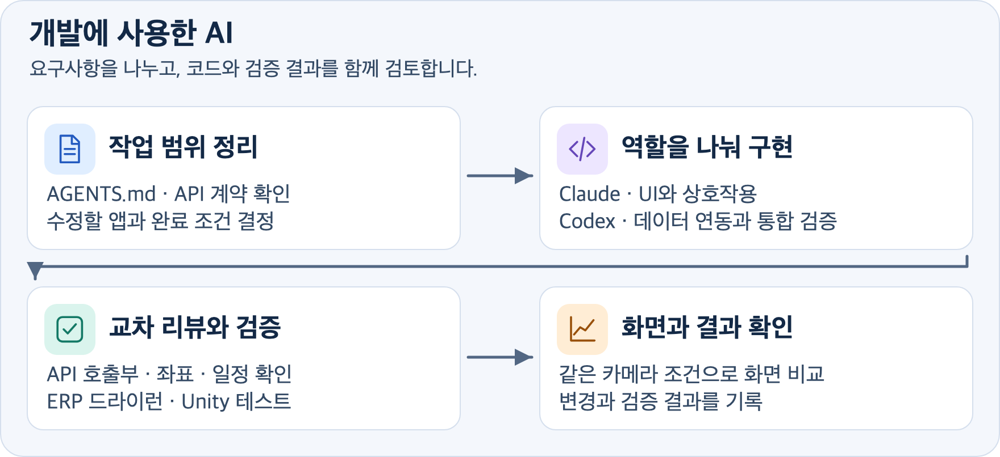
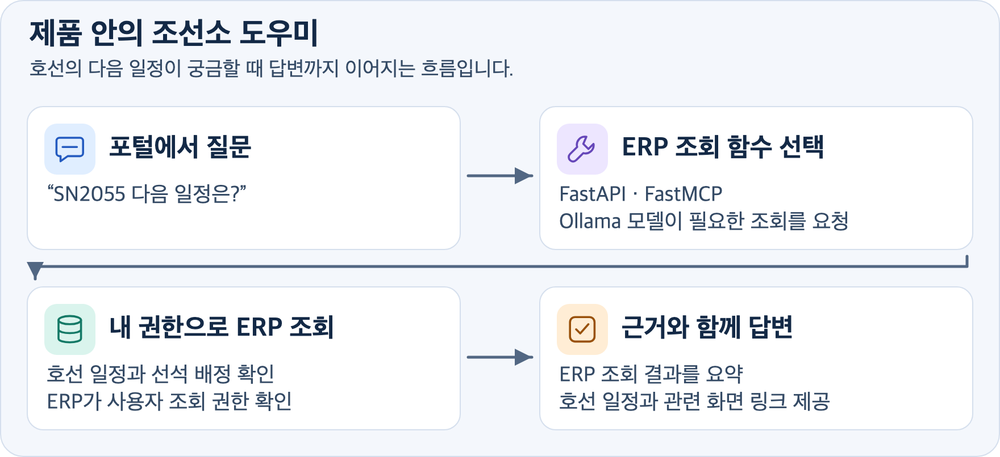
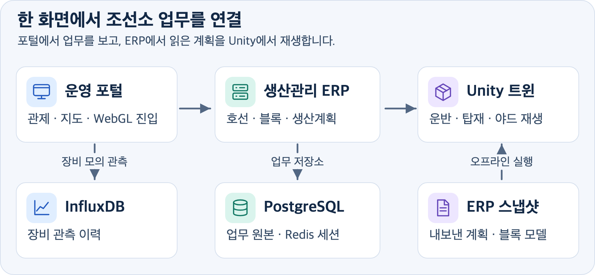

# SIWS · 조선소 생산관리 ERP와 디지털 트윈

호선별 생산계획, 설계·제조 BOM, 작업지시·실적, 블록 이동을 ERP에서 관리합니다. Unity에서는 야드 배치와 도크의 블록 탑재를 3D로 재생합니다. SIWS 포털에서는 ERP, 조선소 지도, 장비 모니터링과 Unity WebGL 디지털 트윈에 접근합니다.

## 개발 기록 · 2026-11-26

| 작업 | 변경 및 확인 범위 |
| --- | --- |
| 야드 셔틀 | 포털에 **야드 셔틀** 카드를, 조선소 지도에 바로가기를 추가했습니다. 위성 지도 위에 A·B 노선과 7개 정류장을 표시합니다. **통합 보기**, **노선**, **정류장**, **배차 시간표** 탭에서 운행 방향, 정류장 순서, 첫차·막차와 다음 출발편을 조회합니다. 브라우저 390px·1280px 폭에서 지도와 탭 전환을 확인했습니다. |
| 남측 야드 도로 | 본 야드와 남측 작업 구역을 잇는 접근로·교량과 자재 트럭 경로를 트윈 소스에 추가했습니다. Unity에서 교량을 포함한 트럭 주행 검증은 남아 있습니다. |
| 3인칭 걸어보기 | 사원·관리자·임원 프리셋을 연결했습니다. 선택을 바꿔도 같은 위치에서 이동할 수 있고, 매달린 소품과 마차 바퀴가 움직임에 반응합니다. 절차형 보행과 저폴리 모델을 사용합니다. EditMode와 이동 캡처를 확인했으며 최신 동작의 브라우저·모바일 검증은 남아 있습니다. |
| 안벽 상세 | ERP의 안벽 ID와 선석 ID를 연결해, 안벽을 클릭하면 소속 선석의 호선 배정과 이동 계획이 표시되도록 수정했습니다. [PR #4](https://github.com/Jihoons-Growthlab/Shipyard-SIWS/pull/4)가 통합 브랜치에 머지됐습니다. |
| 로컬 조선소 도우미 | 포털이 맥북 내부의 `localhost` 요청을 받도록 수정했습니다. 단순 인사에는 조회·추론 없이 답하고, 업무 질문은 ERP 조회와 Ollama를 사용합니다. 로컬 두 주소에서 로그인 후 인사 요청의 정상 응답을 확인했습니다. |
| 친구 시연 | 이메일 일회용 코드와 ERP 읽기 전용 계정을 사용하는 임시 HTTPS 시연 경로를 확인했습니다. 포털·관제·트윈 조회와 업무 변경 차단을 검증했습니다. |

셔틀 노선과 시간표는 시연 데이터입니다. 지도 선은 정류장 간 연결 개요이며, 실제 차량 주행 경로와 트윈 길찾기의 연동은 다음 작업입니다. 안벽 수정은 이미 통합 브랜치에 있고, 표의 셔틀·도로·3인칭·도우미 변경은 개발 작업 트리 기준입니다.

## 화면별 시연

[화면별 GIF와 시연 순서](docs/demo.md) · [기능 명세](docs/spec.md)

### SIWS 포털

통합 포털(8080)은 ERP 계정 로그인, 조선소 운영 지표와 블록 이동 현황, 지도, ERP·Swagger 진입과 Unity WebGL 실행을 제공합니다.

### 장비 모니터링

장비 모니터링은 조선소 지도에서 크레인·중장비·차량의 위치와 운전 상태를 확인하고, 실제 조선소 설비에 연결할 수 없는 환경에서도 **운전 데이터를 생성·수집해 관제 흐름을 검증하는 화면**입니다. 수집을 시작하면 서버가 위치, 속도, 하중 등 장비 유형별 가상 계측값을 주기적으로 생성해 InfluxDB에 시계열 데이터로 저장합니다.

지도에서 장비를 선택하면 최신 관측값, 수집 이력과 360° 3D 모델을 확인할 수 있습니다. ERP의 장비 등록 정보와 시뮬레이션 관측값을 함께 보여주므로, 장비가 등록돼 있어도 아직 수집된 데이터가 없는 상태를 구분할 수 있습니다.

### 생산관리 ERP

[작업지시·품질·블록 이동 시연](docs/media/erp/execution.gif)

### Unity 디지털 트윈

포털의 Unity WebGL 화면에서 기본 시점 → 야드 전체 → 크레인 시점으로 전환한 화면입니다.

#### 호선별 블록 탑재 시뮬레이션

왼쪽 **블록 탑재**에서 호선을 고르면 하단에 도크·인도·크레인 작업과 블록별 탑재 일정이 펼쳐집니다. **재생**을 누르면 계획 순서에 따라 골리앗 크레인이 블록을 들어 올려 도크에 안착시킵니다. 3D 야드의 인양 표시와 함께 기준일, 현재 블록의 작업 진행률, 호선의 누적 탑재 수가 갱신됩니다.

[전체 일정 전환과 다른 호선 시연](docs/demo.md#호선별-블록-탑재-시뮬레이션)

## 구현 기능

| 화면 | 주요 기능 |
| --- | --- |
| Portal | ERP 계정 로그인, 운영 지표·지도 조회, ERP·Swagger·WebGL 진입 |
| 장비 모니터링 | 크레인·중장비·차량의 지도 관제, 3D 모델 조회, 가상 계측값 수집·이력 조회 |
| 업무 홈 | 자재 부족, 구매·작업·이동과 미결 품질 건 확인, 호선별 조회 |
| 대일정 | 호선 주요 일정, 도크 점유, 선석 배정, 일정 변경 이력 |
| 중일정 | 탑재 선후행, 블록 적치·준비, 크레인 부하, 의장 진척, 안벽 이동 |
| 소일정 | 12주 계획·주간 발행, APS 일정 제안, 크레인 작업 배정 |
| EBOM → MBOM → MRP | 도면·설계 BOM 리비전, 제조 공정·투입품, 발행 전 비교, 자재 소요와 부족 근거 |
| 실행 | 구매·입고·출고, 강재 로트, 작업지시·실적, 조립·공수, 의장품, 블록 이동 |
| 진척·품질 | 계획 대비 실적, 물량·공수, 검사 계획·입회 실적, NCR·펀치리스트 |
| 관리·지도 | 기준정보, 시설·도크 배치, 조선소 지도, 그룹별 권한·감사 이력 |
| Unity Twin | 3D 야드, 크레인 탑재 재생, 카메라 프리셋, 대상 툴팁, 수심도 |

## AI를 사용한 개발과 제품 기능

**개발에서는** Claude Code가 트윈의 3인칭 프리셋과 도로 작업을, Codex가 포털 셔틀 화면과 로컬 도우미 응답 검증을 맡았습니다. 앱별 지침과 연동 계약을 읽고, 변경 범위와 검증 결과를 세션 간에 공유했습니다. [AI 작업 절차](docs/ai-workflow.md)

**제품에서는** 조선소 도우미가 사용자 세션으로 ERP 읽기 API를 호출합니다. Ollama 로컬 모델이 조회 결과를 바탕으로 답변하고, 관련 화면 링크를 표시합니다. [도우미 실행 방법](docs/development.md#erp디지털-트윈-챗봇)

## 시스템 아키텍처

SIWS는 하나의 저장소에서 **포털**, **생산관리 ERP**, **Unity 디지털 트윈**을 관리합니다. 브라우저에서 접속하는 포털은 ERP 화면과 API를 프록시하고, Unity WebGL 빌드를 같은 주소에서 제공합니다.

~~~mermaid
flowchart TB
    Browser["브라우저 · 포털 / ERP 화면 / Unity WebGL"]
    Portal["SIWS Portal · Python HTTP · 8080"]
    ERP["생산관리 ERP · Python HTTP · 8001"]
    Browser -->|"화면 요청 · 인증된 API 호출"| Portal
    Portal -->|"WebGL 빌드 제공"| Browser
    Portal -->|"/erp/ · /api/* · /docs 프록시"| ERP
    ERP --> PG["PostgreSQL · 업무 데이터"]
    ERP --> Redis["Redis · 세션과 캐시"]
    Portal --> Equipment["장비 관측 API · 가상 계측 수집기"]
    Equipment --> Influx["InfluxDB · 장비 시계열"]
~~~

| 데이터 흐름 | 현재 동작 |
| --- | --- |
| **로그인과 업무 조회** | 포털의 로그인 요청을 ERP가 처리합니다. 포털은 후속 API 요청의 인증 헤더를 ERP에 전달하고, ERP에서 계정과 업무 권한을 확인합니다. |
| **생산관리 데이터** | PostgreSQL이 호선·블록·BOM·작업지시·도크·탑재 계획의 원본입니다. 포털과 Unity는 ERP API를 통해 조회합니다. |
| **디지털 트윈 조회와 재생** | WebGL은 포털을 통해 ERP API를 호출합니다. macOS 앱은 설정한 ERP 주소로 연결합니다. Unity는 호선별 계획과 모델을 사용해 날짜별 배치와 블록 탑재를 재생합니다. Python 파이프라인으로 내보낸 스냅샷을 빌드에 포함하며, ERP 연결 없이 실행할 때 사용할 수 있습니다. |
| **생산 관제** | 포털 `/control`은 호선별 주간 탑재 계획(기준·예상)과 확정 실적(탑재 검사 합격, 블록당 한 번)을 간트로 보여 줍니다. 지연 블록의 원인은 NCR·ITP·탑재 검사 불합격·자재 미출고·선행 공정·선행 블록·미확정 이동·준비 보류 기록에서만 찾고, 근거가 없으면 '미확인'으로 표시합니다. 블록의 마지막 확정 위치(최종 이동 확정 시설)는 조선소 지도(`/map#block=…`)로, 수정은 ERP 화면(`/erp/#open=<조회>&q=<ID>`)으로, 모의 재생은 웹 트윈(`/twin/?hull=…&block=…`)으로 이어집니다. 새 API나 스키마 없이 ERP 조회 검색(`?hull=`, `f.<열>=`)만 씁니다. |
| **장비 모니터링** | 지도는 ERP의 장비 등록 정보와 모의 관측값을 함께 표시합니다. 관리자가 수집을 시작하면 포털의 시뮬레이터가 크레인·중장비·차량의 계측값을 생성해 InfluxDB에 기록합니다. 관측 API는 ERP 세션을 확인한 뒤 수집 상태와 최근 기록을 반환합니다. |

[ERP–Twin 데이터 계약](shared/contracts/README.md) · [Twin 스냅샷 형식](apps/twin/docs/TWIN_FORMAT.md)

| 경로 | 구성 |
| --- | --- |
| apps/portal | 포털 화면, Python ERP 프록시, 장비 데이터 시뮬레이션·수집 |
| apps/erp | Python HTTP API, JavaScript 업무 화면, 생산·BOM·야드 업무 모듈 |
| apps/assistant | FastAPI·FastMCP 조선소 도우미, ERP 조회와 Ollama 연동 |
| apps/twin/unity | Unity 6 · C# · URP · UI Toolkit. 야드 렌더링, 탑재 재생과 패널 |
| apps/twin/pipeline | 예시 시설·블록·운영계획 생성, OBJ 모델 생성, 스냅샷 내보내기 |
| shared/contracts | ERP–Twin 데이터 연동 기준 |
| shared/unity-packages | 공용 Unity 패키지 |
| tools | 로컬 실행과 데이터 이관 |

## 실행

[로컬 개발 가이드](docs/development.md)에서 최초 설치와 환경변수 설정을 마친 뒤, 저장소 루트에서 실행합니다.

| 서비스 | 명령 | 접속 |
| --- | --- | --- |
| PostgreSQL 17 · Redis | `tools/dev db-up` | 55432 · 56379 |
| InfluxDB | `tools/dev equipment-db-up` | 장비 계측 시계열 저장 |
| ERP | `tools/dev erp` | [ERP](http://127.0.0.1:8001/) · [Swagger](http://127.0.0.1:8001/docs) |
| Portal | `tools/dev portal` | [Portal](http://127.0.0.1:8080/) |
| Unity WebGL | `apps/twin/tools/build-web.sh` | [포털 디지털 트윈](http://127.0.0.1:8080/twin/) |
| Unity Twin | `tools/dev twin-build` 후 `tools/dev twin-run` | macOS 앱 · 에디터 6000.3.23f1 |

- [ERP 업무 흐름](apps/erp/docs/ERP_WORKFLOW.md) · [ERP 사용 가이드와 API](apps/erp/README.md)
- [Unity 실행과 데이터 갱신](apps/twin/README.md) · [Unity 코드 구조](apps/twin/docs/project-map.md)
- [ERP–Twin 연동 기준](shared/contracts/README.md) · [스냅샷 형식](apps/twin/docs/TWIN_FORMAT.md)
