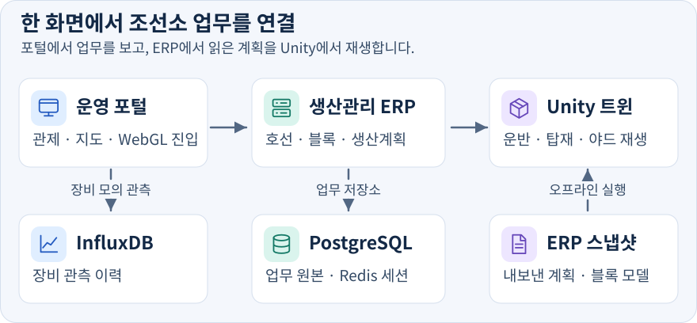
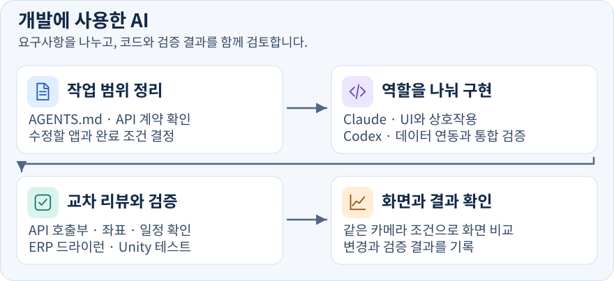
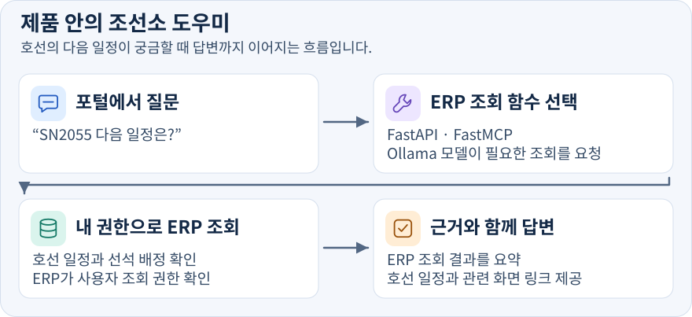

# SIWS · 조선소 생산관리 ERP와 디지털 트윈

호선·블록·공정·장비 데이터를 ERP에서 관리하고, 생산관제와 조선소 지도, Unity 디지털 트윈에서 같은 계획을 확인하는 프로젝트입니다. 포털에서 지연 블록을 찾으면 ERP에서 기록을 확인하거나, 트윈에서 해당 블록의 운반과 탑재를 재생할 수 있습니다.

[화면 시연](demo.md) · [로컬 실행](development.md) · [기능 명세](spec.md)


## 시스템 아키텍처



ERP는 생산·품질·의장·야드 업무를 Python 모듈로 나누고 하나의 HTTP 서버에서 실행합니다. 포털과 트윈은 호선·블록·시설·장비 ID로 데이터를 연결합니다. Unity 클라이언트는 ERP 연결 시 계획을 읽고, 오프라인에서는 빌드에 포함된 스냅샷을 사용합니다. 호선별 공유 재생에서는 ERP가 계산한 같은 시각의 블록·장비 상태를 포털과 Unity가 표시합니다.

[ERP–Twin 데이터 계약](../shared/contracts/README.md) · [Twin 스냅샷 형식](../apps/twin/docs/TWIN_FORMAT.md)

## 폴더 구조

```text
SIWS/
├── apps/
│   ├── erp/                    생산관리 API, 업무 규칙, ERP 웹 화면
│   ├── portal/                 포털, 생산관제, 지도, 장비 관측 수집
│   ├── assistant/              FastAPI·FastMCP 기반 조선소 도우미
│   └── twin/
│       ├── pipeline/           ERP 내보내기, 야드·블록·모델 생성
│       ├── tools/              Unity 테스트, WebGL·macOS 빌드, 화면 캡처
│       └── unity/Assets/ShipyardTwin/
│           ├── Authoring/      씬·UI 구성 원본
│           ├── Editor/        씬 생성과 빌드
│           ├── Runtime/       데이터 조회, 재생, 렌더링, 화면
│           └── Tests/         EditMode·PlayMode 테스트
├── shared/
│   ├── contracts/              API 필드, ID, 좌표·시각 연동 기준
│   └── unity-packages/         공용 GrowthLab Unity 패키지
├── tools/                      개발 실행, 검증, 데이터 이관
├── ops/nginx/                  리버스 프록시 설정
└── docs/                       명세, 개발 가이드, 시연, 작업 인수인계
```

## AI를 개발에 어떻게 활용했나요?



Claude와 Codex를 사용해 요구사항을 코드 변경과 검증으로 연결했습니다. 작업에 따라 역할을 조정하며, 기본적으로 Claude는 UI와 상호작용을, Codex는 ERP·포털·Unity 간 데이터 연동과 통합 검증을 맡았습니다.

| 사용한 방법 | SIWS에서의 적용 |
| --- | --- |
| **저장소 문서로 컨텍스트 제공** | `AGENTS.md`와 앱별 가이드에서 담당 파일을 찾고, 좌표·시각·ID 같은 연동 규칙은 `shared/contracts/`에서 확인했습니다. |
| **작업 분리와 교차 리뷰** | 변경할 앱과 파일을 먼저 나눴습니다. 병렬 구현에는 작업별 브랜치와 worktree를 사용하도록 절차를 정리했고, 리뷰에서는 변경분과 호출부, API 계약을 확인합니다. |
| **데이터와 화면을 함께 검증** | ERP 쓰기 규칙을 거치는 데모 데이터 스크립트를 만들고, 적용 전에 롤백 방식으로 검증했습니다. Unity 변경은 EditMode 테스트와 빌드를 거치고, 시각 문제는 같은 카메라 조건의 캡처로 확인했습니다. |
| **근거를 남기는 인수인계** | 변경 범위, 검증 결과, 남은 확인 항목을 PR 또는 `docs/handoffs/`에 기록해 다음 세션이 이어서 작업할 수 있게 했습니다. |

예를 들어 블록이 공중에서 움직이는 문제는 **ERP 장비 ID → 트랜스포터 운반 → 골리앗 인양**으로 나눠 추적했습니다. ERP의 적치 슬롯과 크레인 배정 시각을 사용하고, 도로 정보가 있는 야드에서는 도로망 경로를 적용했습니다. 수심도 깜빡임은 파도 높이와 표시 면이 겹치는 부분을 찾아 수정한 뒤, 같은 원거리 시점에서 수심도 켜기·끄기 화면을 비교했습니다.

[AI 작업·리뷰 절차](ai-workflow.md) · [Unity 작업별 경로](../apps/twin/docs/project-map.md) · [검증 스크립트](../tools/verify)

## 제품 안에서 AI를 어떻게 사용하나요?



**조선소 도우미**는 작업 화면에서 호선 일정, 블록 상태, 야드 계획 같은 ERP 정보를 자연어로 조회합니다. 개발에 사용한 Claude·Codex와 별도로, 도우미 서버는 Ollama의 로컬 모델을 호출합니다. 기본 설정은 `qwen3:4b`입니다.

1. 포털이 질문과 ERP 세션을 도우미 서버로 전달합니다.
2. 서버가 ERP 세션을 확인하고, 질문에 맞는 조회 함수를 선택합니다. 모델도 FastMCP에 등록된 함수 목록에서 필요한 조회를 요청할 수 있습니다.
3. 조회 함수는 사용자 세션으로 ERP API를 호출합니다. 응답에는 조회 결과를 바탕으로 작성한 설명과 관련 화면 링크를 담습니다.

이 흐름의 핵심은 **함수 호출을 이용한 실시간 구조화 데이터 조회**입니다. 업무 데이터와 조회 권한은 ERP가 관리하며 도우미의 등록 도구는 읽기 조회에 사용합니다. 생산 계획과 유니티 재생은 각각 ERP 업무 규칙과 재생 코드가 계산합니다.

[도우미 서버 구현](../apps/assistant/server.py) · [포털 연동](../apps/portal/portal.py)

## 로컬 실행과 검증

최초 설치와 접속 설정은 [로컬 개발 가이드](development.md)를 참고합니다.

```sh
tools/dev db-up
tools/dev erp
tools/dev portal
```

ERP와 포털은 각각 별도 터미널에서 실행합니다. Unity는 `apps/twin/unity`를 열거나 `apps/twin/tools/build-web.sh`로 웹 빌드를 만들어 포털의 `/twin/`에서 확인합니다.

```sh
tools/verify erp portal
tools/verify twin
```
